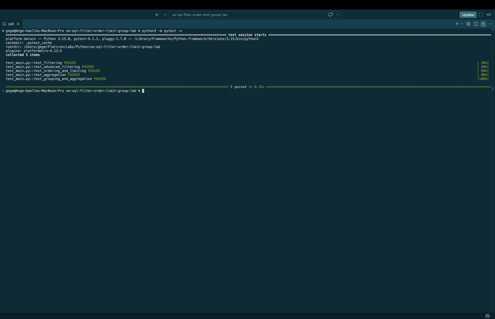

# SQL Lab: Filtering, Ordering, Limiting, and Grouping Data

## Overview

This lab focuses on writing SQL queries to retrieve, filter, sort, and analyze data stored in SQLite databases.

Using Python, Pandas, and SQLite, I practiced querying relational databases and working with the results as Pandas DataFrames.

## Technologies Used

- Python 3
- SQLite3
- Pandas
- Pytest
- Git and GitHub

## Project Structure

```text
se-sql-filter-order-limit-group-lab/
├── main.py
├── test_main.py
├── planets.db
├── dogs.db
├── babe_ruth.db
├── Pipfile
├── Pipfile.lock
└── README.md
```

## Lab Sections

### Part 1: Basic Filtering

Used SQL's `WHERE` clause to filter planetary data.

- Retrieved planets with zero moons.
- Retrieved planet names containing exactly seven characters using `LENGTH()`.

### Part 2: Advanced Filtering

Practiced combining conditions and searching text.

- Filtered planets by mass.
- Used `AND` to combine multiple conditions.
- Used `LIKE` and `%` to search for colors containing "blue".

### Part 3: Ordering and Limiting

Queried a database containing fictional dogs.

- Filtered hungry dogs.
- Sorted results using `ORDER BY`.
- Filtered dogs within an age range using `BETWEEN`.
- Used `LIMIT` to retrieve the four oldest dogs.

### Part 4: Aggregation

Analyzed Babe Ruth's baseball statistics.

- Used `COUNT()` to calculate the number of seasons recorded.
- Used `SUM()` to calculate total career home runs.

### Part 5: Grouping and Aggregation

Practiced grouping records and calculating aggregate values.

- Used `GROUP BY` to count seasons played for each team.
- Used `AVG()` to calculate average at-bats.
- Used `HAVING` to filter grouped results.

## SQL Concepts Practiced

| SQL Keyword | Purpose |
|-------------|---------|
| SELECT | Retrieves data from a table |
| FROM | Specifies the table |
| WHERE | Filters rows based on conditions |
| AND | Combines multiple conditions |
| LIKE | Searches for matching text patterns |
| LENGTH() | Counts characters in a string |
| BETWEEN | Filters values within a range |
| ORDER BY | Sorts query results |
| ASC | Sorts in ascending order |
| DESC | Sorts in descending order |
| LIMIT | Restricts the number of returned rows |
| COUNT() | Counts records |
| SUM() | Calculates a total |
| AVG() | Calculates an average |
| GROUP BY | Groups records by shared values |
| HAVING | Filters grouped results |

## Installation and Setup

### 1. Clone the Repository

```bash
git clone git@github.com:a-gbatie/se-sql-filter-order-limit-group-lab.git
cd se-sql-filter-order-limit-group-lab
```

### 2. Install Dependencies

```bash
python3 -m pip install pandas pytest
```

### 3. Run the Program

```bash
python3 main.py
```

## Testing

Run all tests with:

```bash
python3 -m pytest -v
```

## Screenshot of Completed Tests

